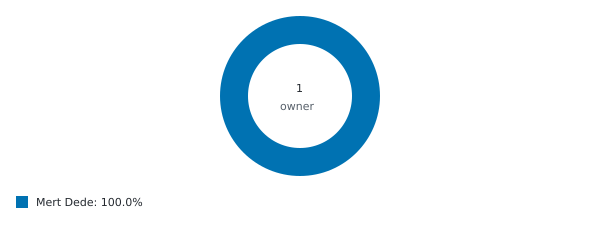
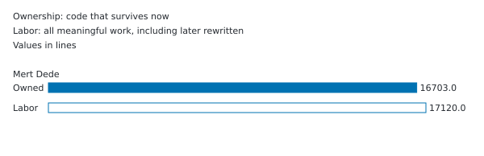
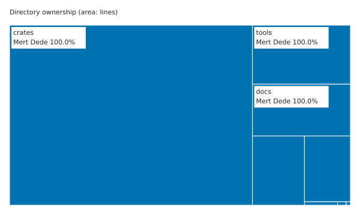
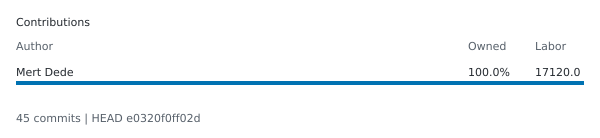
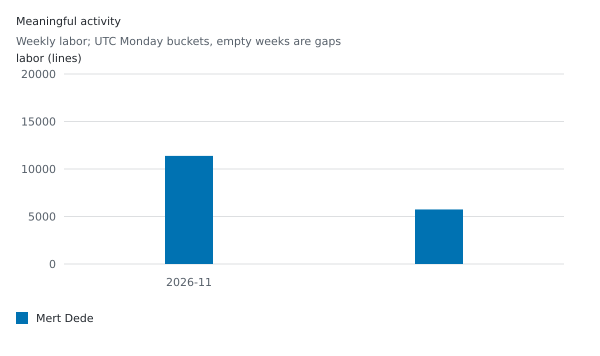
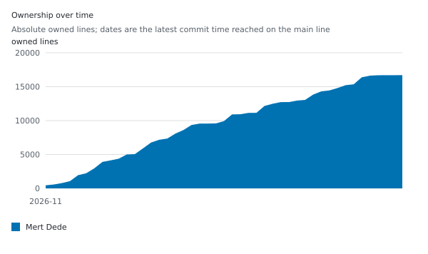

# git-credit

[](https://github.com/avhn/git-credit/actions/workflows/ci.yml)
[](https://github.com/avhn/git-credit/releases/latest)
[](#license)

**Fair git authorship stats.** `git-credit` shows who wrote how much of a repository
and how much work each person put in, without letting a formatter run, a renamed
variable or a one-character fix take the credit away from the original author.

```sh
curl -fsSL https://raw.githubusercontent.com/avhn/git-credit/main/install.sh | sh
cd your-repo && git credit analyze
```

## The problem

`git blame` gives a whole line to whoever touched it last. Here is a small project
with four commits:

1. **Alice** writes `src/cart.js`: cart totals, discounts and price formatting.
2. **Bob** runs a code formatter over it (re-indents, wraps long lines, adds
   trailing commas). No behavior changes.
3. **Carol** fixes one discount value: `0.8` becomes `0.75`.
4. **Dave** adds a new `shippingCost` function.

Counting `git blame` lines per author (the approach most contribution tools use):

```console
$ git blame --line-porcelain src/cart.js | sed -n 's/^author //p' | sort | uniq -c | sort -rn
     16 Bob
     10 Alice
      8 Dave
      1 Carol
```

Bob "wrote" the most code by running a formatter, and Carol owns the whole
discount line for changing two characters. The same repository with `git-credit`:

```console
$ git credit analyze
AUTHOR  OWNERSHIP %  OWNED LINES  LABOR
Alice         79.5%         23.9  17.0
Dave          20.0%          6.0  6.0
Carol          0.5%          0.1  0.1
HEAD e5c6d840fbfd | 4 commits | full | token | algorithm 4
Provenance metrics do not measure a person's value.
```

Bob's reformat earns nothing and takes nothing, so he does not appear. Alice keeps
the code she wrote, Carol is credited with exactly the token she changed, and
Dave owns his new function.

On a terminal the header is bold, each author's row and inline bar uses the same
color order as the charts, and the footer is dim. Percentages remain visible:

```console
$ git credit analyze --bars --ascii
AUTHOR  OWNERSHIP %  OWNED LINES  LABOR  OWNERSHIP
Alice         79.5%         23.9  17.0   ################....
Dave          20.0%          6.0  6.0    ####................
Carol          0.5%          0.1  0.1    ....................
```

The sample describes colors rather than embedding ANSI in Markdown. Redirected
output stays plain and unchanged by default. Use `--tree --depth 2` for directory
owners, `--no-color` or nonempty `NO_COLOR` to disable color, and
`--color always --bars` to capture ANSI deliberately. See [terminal flags](docs/usage.md).

## Two numbers per person

| Column        | Question it answers                                      | Goes down when                          |
| ------------- | -------------------------------------------------------- | --------------------------------------- |
| **Ownership** | Who wrote the meaningful code that exists right now?     | Their code is genuinely rewritten or deleted |
| **Labor**     | Who did the meaningful work across the whole history?    | Never, other people's edits cannot reduce it |

Labor is measured in line-equivalents: a new line earns 1.0, changing one token of
a ten-token line earns 0.1, deleting and formatting earn nothing.

## What counts and what does not

- **Formatting is free.** Re-indenting, rewrapping, joining lines and trailing
  commas earn nothing and take nothing (indentation still counts in Python and YAML).
- **Small edits take only what they change.** Credit is tracked per token, so a
  fixed typo does not take over the line.
- **Moved and renamed code keeps its author**, even when it is slightly edited
  during the move.
- **Find-and-replace renames keep their author.** The person running the rename
  earns a small fixed amount of labor, not ownership of every touched line.
- **Pull requests credit their authors, not whoever clicked merge.**
- **One person, one row.** `.mailmap` is applied, identities with the same name are
  merged, and `Co-authored-by:` trailers split credit.
- **Noise is ignored:** lockfiles, vendored and generated code, minified files,
  binaries.

The full rules are in the [usage reference](docs/usage.md#how-credit-is-decided).

## Install

| Platform           | Command                                                                                      |
| ------------------ | -------------------------------------------------------------------------------------------- |
| macOS, Linux       | `curl -fsSL https://raw.githubusercontent.com/avhn/git-credit/main/install.sh \| sh`          |
| Windows            | `irm https://raw.githubusercontent.com/avhn/git-credit/main/install.ps1 \| iex`             |
| Homebrew           | `brew install avhn/tap/git-credit`                                                           |
| Debian, Ubuntu     | signed APT repository, [see below](#apt)                                                     |
| Rust toolchain     | `cargo install --git https://github.com/avhn/git-credit --tag v0.1.1 --locked git-credit`    |

The install scripts need no administrator rights: they download the latest release
for your platform, verify it against the release's `SHA256SUMS`, and install to
`~/.local/bin` (Windows: `%LOCALAPPDATA%\Programs\git-credit`, added to your PATH).
Set `GIT_CREDIT_VERSION=0.1.1` to pin a version or `GIT_CREDIT_INSTALL_DIR` to
choose the location. Homebrew and APT add signed packages and `upgrade` support.

Because the binary is named `git-credit`, Git also runs it as `git credit`.

### APT

Debian 11+ and Ubuntu 20.04+, amd64 and arm64:

```sh
curl -fsSL https://avhn.github.io/git-credit/apt/git-credit-archive-keyring.gpg \
  | sudo tee /usr/share/keyrings/git-credit-archive-keyring.gpg > /dev/null
echo 'deb [signed-by=/usr/share/keyrings/git-credit-archive-keyring.gpg] https://avhn.github.io/git-credit/apt stable main' \
  | sudo tee /etc/apt/sources.list.d/git-credit.list
sudo apt update && sudo apt install git-credit
```

The repository signing key fingerprint is
`097D DFE9 2CE4 B0F4 E204 F434 668F 8E1D 7564 56FD`
(check with `gpg --show-keys /usr/share/keyrings/git-credit-archive-keyring.gpg`).
Standalone `.deb` files and archives for every platform are attached to each
[release](https://github.com/avhn/git-credit/releases/latest). Details:
[packaging and signing](docs/packaging.md).

## Usage

```console
$ git credit analyze                         # table for the current repository
$ git credit analyze ../other-repo           # any path, including bare repositories
$ git credit analyze --json > credit.json    # machine-readable report
$ git credit analyze --exclude 'docs/**'     # leave paths out
$ git credit analyze --by-email              # do not merge people who share a name
$ git credit badge --out-dir badges          # SVG badges and a summary card
```

The JSON report adds per-directory ownership, the policy used, and every email
merged into each person:

```json
{
  "name": "Alice",
  "email": "alice@example.com",
  "emails": ["alice@example.com"],
  "ownership_lines": 23.862068,
  "ownership_share": 0.7954022666666667,
  "labor": 17.0
}
```

The first run on a large repository replays the full history (tokio, about 4,000
commits, takes about a minute). Results are cached inside `.git`, so later runs
only process new commits: on [fd](https://github.com/sharkdp/fd), 52 new commits
took 0.8 seconds instead of 7.8. Shallow clones are refused; run
`git fetch --unshallow` first.

Optional settings live in `.git-credit.toml` at the repository root:

```toml
exclude = ["generated/**", "fixtures/**"]
opt_out = ["private@example.com"]   # shown as one anonymous row
group_by = "email"                  # keep people who share a name apart
```

Every flag, the configuration keys, identity handling and the cache are described
in the [usage reference](docs/usage.md). The JSON shape is versioned and documented
in [json.md](docs/json.md).

## Badges for your README

`git credit badge` renders these from the same analysis. This repository's own,
regenerated on every push:

<picture>
  <source media="(prefers-color-scheme: dark)" srcset="https://raw.githubusercontent.com/avhn/git-credit/badges/credit-bar-dark.svg">
  <source media="(prefers-color-scheme: light)" srcset="https://raw.githubusercontent.com/avhn/git-credit/badges/credit-bar.svg">
  
</picture>

<picture>
  <source media="(prefers-color-scheme: dark)" srcset="https://raw.githubusercontent.com/avhn/git-credit/badges/credit-donut-dark.svg">
  <source media="(prefers-color-scheme: light)" srcset="https://raw.githubusercontent.com/avhn/git-credit/badges/credit-donut.svg">
  
</picture>

<picture>
  <source media="(prefers-color-scheme: dark)" srcset="https://raw.githubusercontent.com/avhn/git-credit/badges/credit-labor-dark.svg">
  <source media="(prefers-color-scheme: light)" srcset="https://raw.githubusercontent.com/avhn/git-credit/badges/credit-labor.svg">
  
</picture>

<picture>
  <source media="(prefers-color-scheme: dark)" srcset="https://raw.githubusercontent.com/avhn/git-credit/badges/credit-treemap-dark.svg">
  <source media="(prefers-color-scheme: light)" srcset="https://raw.githubusercontent.com/avhn/git-credit/badges/credit-treemap.svg">
  
</picture>

<picture>
  <source media="(prefers-color-scheme: dark)" srcset="https://raw.githubusercontent.com/avhn/git-credit/badges/credit-card-dark.svg">
  <source media="(prefers-color-scheme: light)" srcset="https://raw.githubusercontent.com/avhn/git-credit/badges/credit-card.svg">
  
</picture>

<picture>
  <source media="(prefers-color-scheme: dark)" srcset="https://raw.githubusercontent.com/avhn/git-credit/badges/credit-activity-dark.svg">
  <source media="(prefers-color-scheme: light)" srcset="https://raw.githubusercontent.com/avhn/git-credit/badges/credit-activity.svg">
  
</picture>

<picture>
  <source media="(prefers-color-scheme: dark)" srcset="https://raw.githubusercontent.com/avhn/git-credit/badges/credit-history-dark.svg">
  <source media="(prefers-color-scheme: light)" srcset="https://raw.githubusercontent.com/avhn/git-credit/badges/credit-history.svg">
  
</picture>

The activity chart shows meaningful labor with empty periods kept as gaps. Ownership
history shows absolute owned lines, so repository growth stays visible. Both use
shared contributor colors, top-N legends and neutral gray Others. Timeline analysis
is automatic for `badge --style all`, `activity` and `history`.

The bar remains the lead chart. Donut slices are not inflated; labor includes
meaningful work later rewritten. Treemap area is directory ownership, with color
identifying the leading owner. GitHub supports these `<picture>` sources and
selects the reader's color scheme.


To keep them up to date in your own repository, add this workflow. It runs on every
push to `main` and publishes the images to a `badges` branch:

```yaml
# .github/workflows/badges.yml
name: Badges
on:
  push:
    branches: [main]
permissions:
  contents: write
jobs:
  badges:
    runs-on: ubuntu-latest
    steps:
      - uses: actions/checkout@v7
        with:
          fetch-depth: 0
      - uses: avhn/git-credit@v0.1.1
```

Then reference them, for example
``.
All action inputs, styles, themes, shields.io endpoints and privacy notes:
[badges.md](docs/badges.md).

## Limits

- These numbers describe **who wrote what**, not how valuable anyone's work is. A
  one-line security fix can matter more than a thousand generated lines.
- The tokenizer is language-agnostic, not a full parser. It handles most languages
  well but does not understand every syntax.
- Merging identities by name can merge two different people with the same name;
  use `--by-email` or a `.mailmap` when that happens.

## Development

```console
$ git clone https://github.com/avhn/git-credit && cd git-credit
$ git config core.hooksPath .githooks    # commit message and formatting checks
$ cargo test --workspace
$ cargo lint                             # clippy with the CI flags
$ cargo run -- analyze .
```

Requires stable Rust via [rustup](https://rustup.rs) (`rust-toolchain.toml` selects
it). Commits follow Conventional Commits (`type(scope): summary`). Architecture and
design decisions: [PLAN.md](docs/PLAN.md); performance: [PERFORMANCE.md](docs/PERFORMANCE.md).

```text
crates/
  credit-core/   attribution engine: tokens, diffs, ownership and labor (no I/O)
  credit-git/    reads the repository: history, renames, .mailmap, co-authors, cache
  credit-badge/  SVG badges, cards and shields.io endpoint JSON
  git-credit/    the command-line tool
```

## License

Licensed under either of [Apache License, Version 2.0](LICENSE-APACHE) or
[MIT license](LICENSE-MIT) at your option. Unless you explicitly state otherwise,
any contribution intentionally submitted for inclusion in the work by you, as
defined in the Apache-2.0 license, shall be dual licensed as above, without any
additional terms or conditions.
