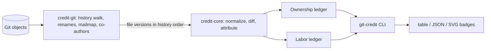
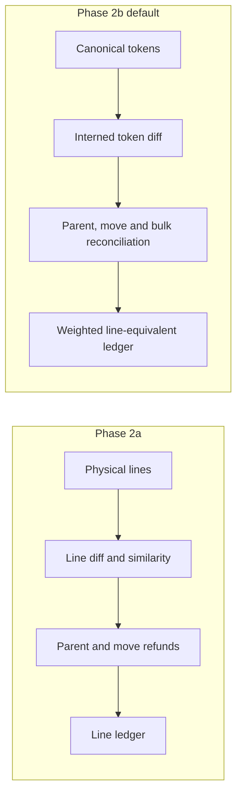
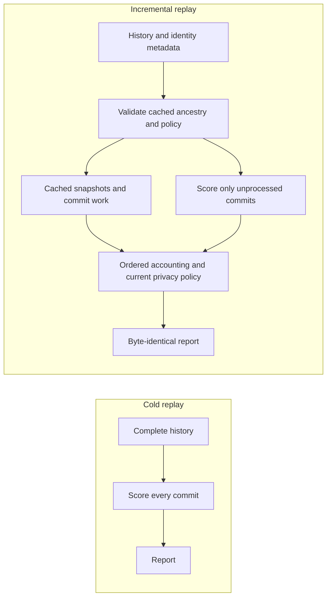
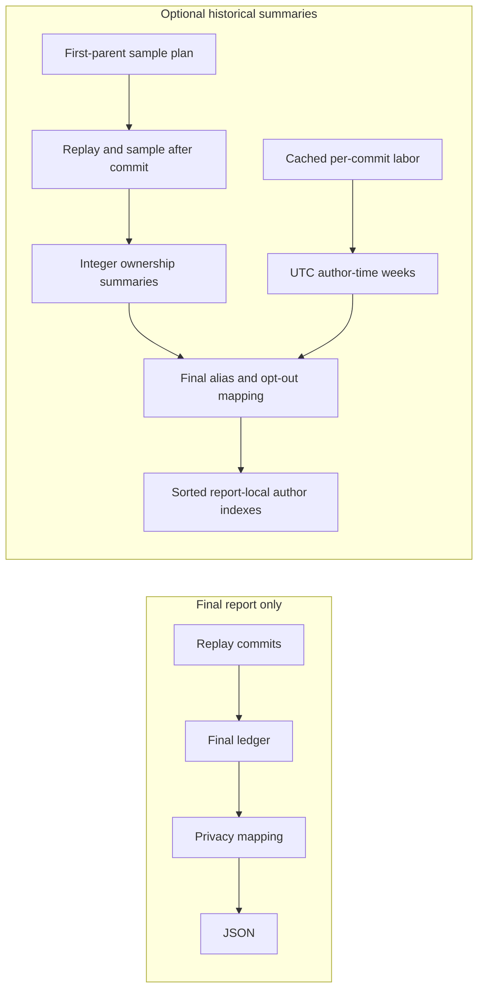

# git-credit: architecture and roadmap

This document holds the design decisions behind `git-credit`. It was drafted on
2026-11-08 from a planning pass and an independent review of that plan, then
narrowed by owner decisions. Change it in the same commit as any change to
attribution behavior.

## Goal

Per-author contribution stats for a Git repository that do not let trivial edits
steal credit, reported as two independent numbers:

- **Ownership**: share of the meaningful content at `HEAD`, attributed to the
  authors whose work survives in it.
- **Labor**: meaningful work across all analyzed history, including content later
  rewritten or deleted. For a fixed history and policy it never decreases because
  of other people's later edits.

These metrics describe provenance. They do not measure a person's value: a
one-line security fix can matter more than a thousand lines of boilerplate. The
README and reports say so.

## Architecture

| Crate         | Responsibility                                                              | Runtime dependencies           |
| ------------- | --------------------------------------------------------------------------- | ------------------------------ |
| `credit-core` | Normalization, diff, attribution, aggregation over in-memory inputs; no I/O | `similar` (from Phase 1)       |
| `credit-git`  | Object access, commit walk, rename detection, `.mailmap`, trailers          | `gix`                          |
| `credit-badge` | Pure deterministic SVG and shields.io JSON from privacy-filtered summaries | None (std only)              |
| `git-credit`  | CLI, configuration, orchestration, table, JSON and SVG output               | `clap`, `serde`, `toml`, `globset` |
| Token lexer in `credit-core` (Phase 2b) | Language-independent canonical tokens | No additional dependencies |

### Dependency decisions

- **`gix` over `git2`:** permissive license (MIT OR Apache-2.0), pure Rust so no
  libgit2 native build on Windows, efficient object and tree access for replay. Its
  blame is not used: attribution needs custom provenance rules anyway.
- **`similar` in `credit-core`:** the core targets zero runtime dependencies, so this
  is a recorded exception. std has no diff algorithm; writing and maintaining a
  correct Myers or histogram diff is a project of its own. `similar` is
  Apache-2.0, widely used (it backs `insta`), maintained, and has no required
  dependencies. Phase 2b benchmarks below compare it with `imara-diff` histogram
  on ordinary edits, repetitive tokens, generated files and near-total rewrites.
  Myers remains the runtime choice; deterministic tie-breaking is part of
  algorithm version 3.
- All dependencies must pass `cargo deny` (permissive licenses only, crates.io only).

## Attribution model

### History walk (Phase 2a: merge-aware full graph)

Algorithm version 2 defaults to `full`: enumerate all commits reachable from HEAD
and replay each exactly once. A deterministic topological schedule visits parents
before children and breaks ready-commit ties by object ID, not timestamp. Identity
participation and labor are accumulated once per visited commit.

Each commit starts with a clone of its first parent's ordered path map. Map values
are shared `Arc` handles to immutable scored blobs and file attribution. Remaining
child counts release a commit state immediately after its last reachable child
consumes it. HEAD supplies final ownership. Memory is O(reachable commits and edges)
for graph metadata, plus concurrently open branch states and transient diffs, not
historical file contents. Verbose diagnostics report peak retained states, including
the current output state before consumed parents are released.

Non-merge commits keep the line-level diff, rename, move and labor rules below.
For merges, diff against the first parent and consider other parents in recorded
Git parent order:

1. An exact blob ID match at the destination path, or a rename source reported by
   gix, adopts that parent's entire file attribution unchanged with zero labor.
2. Otherwise apply the ordinary first-parent change. For each newly inserted or
   rewritten editor line, match identical normalized text in other parents at that
   path (including detected rename sources). The first parent match, then earliest
   physical line, wins. Restore that owner and refund exactly that line's recorded
   labor shares. Repeated text uses the first match; this is provenance matching,
   not a claim of unique source-line consumption.
3. Unmatched editor lines remain conflict-resolution work. Retained lines and small
   edits retain their ordinary scoring. Deletions remain deletions even when another
   parent contains the path. Reconcile same-commit moves after parent matching.
   Exact adoption preserves first-parent removal metadata. Source-only diffs against
   every other parent also supply removed blocks, even for paths unchanged against
   the first parent. Shared normalized text occurrences at a path are deduplicated
   across parents, with first-parent precedence, to prevent duplicate move refunds.
   This conservative union can split overlapping blocks; three consecutive removed
   lines are still required. Source-only diffs never contribute labor or live state.

The optional search across unrelated first-parent paths is not implemented. Matching
is line-level, not semantic conflict understanding. The isolated raw-object diff
cache remains shared across the walk, with transient blob resources cleared after
each tree comparison. Repository attributes, diff drivers and textconv cannot run.

`--first-parent` or `walk = "first-parent"` in `.git-credit.toml` selects the legacy
walk. It visits only the first-parent chain and warns that merge diff attribution
is approximate. The default and `walk = "full"` preserve branch provenance and do
not emit that warning. The CLI flag overrides the configured walk.

### Normalization (Phase 1)

Lines are the unit in Phase 1. Comparison uses a conservative normalization:
trailing whitespace is ignored and line-ending differences (CRLF vs LF) are
ignored. Leading indentation is also ignored for files whose language does not
give indentation meaning; for indentation-sensitive files (Python, YAML, Makefile,
and unknown extensions) indentation is kept, because there it can be a real change.
Interior whitespace, string contents and comments are compared as written.
Blank lines (empty after normalization, including whitespace-only lines) have
zero ownership weight and earn zero labor. They remain in file state for physical
alignment and move matching. All line diffs operate on the normalized nonblank
sequence, then map attribution and insertion candidates back to physical positions.
This applies to mixed meaningful/blank edits as well as formatting-only changes:
blank runs cannot become diff anchors that transfer unchanged meaningful content.
Adding, removing or relocating only blank lines is formatting. This corrects the
initial unreleased core's physical-line counting and alignment during Phase 1 review.
A commit whose included nonblank content is unchanged under normalization is a
**formatting commit**: it earns no labor and transfers no ownership. Renames and
moves remain meaningful structural changes. Commits containing only excluded
changes also count as formatting for the selected policy.

### Small edits keep the original author (Phase 1)

Owner decision: a similarity threshold.

Within a changed hunk, each new line is paired with the most similar old line in
that hunk (character-level similarity ratio, ties broken by position). For a pair
with similarity `s` (0 to 1):

- `s >= keep` (default `keep = 0.70`, meaning less than 30% changed): the line
  **keeps its previous owner**. The editor earns labor `1 - s` for the change.
- `s < keep`: the line is a rewrite. The editor **owns** it and earns labor 1.

Unpaired new lines are owned by the editor with labor 1. Deleted lines remove
ownership but never remove past labor. `keep` is configurable in `.git-credit.toml`.

The core implementation uses deterministic Myers diffs over nonblank normalized
lines. Character similarity is twice the Unicode scalar longest-common-subsequence
(LCS) length divided by the combined character count. Short lines use Myers to
obtain that count. For pairs with at least 256 scalars on each side and at most
128 distinct old scalars, an exact bit-parallel LCS computes the same count with
O(new length * ceil(old length / 64)) word operations. Mask storage is bounded by
the old alphabet and line length. This avoids the quadratic edit-distance cost of
large single-line SVGs without approximating scores or changing tie-breaking.
Differential tests check word boundaries, Unicode and agreement with Myers.
Cached character frequencies and length bounds skip only pairs that provably
cannot beat the current best score. Threshold comparisons use exact integer ratios. New lines are visited in order and each old line can be paired
only once. If a replacement hunk has more than 250,000 old/new candidate pairs,
pairing is skipped, the hunk is treated as a rewrite, and the core returns a
`pairing_capped` warning flag for the report layer.

Ownership and labor both use millionths of a line. Equal co-author ownership
splits allocate remainder units to the earliest authors in caller order.
Fractional labor rounds upward to the nearest millionth; cumulative integer
apportionment splits that amount among commit authors without losing units.
Blank physical lines have zero weight; a terminal newline does not add a line.
The presence or absence of the terminal newline alone is formatting. CLI and
configuration thresholds are rounded to the nearest per-mille value; reports
include the effective threshold, not the unquantized input.

Phase 2 refines this to tokens: unchanged tokens keep their provenance, inserted
and replaced tokens belong to the editor. The review of the original plan rejected
fractional ownership shares because they made results depend on statement size.

### Moves, copies and renames

Phase 1: renames are followed by exact content match and by similarity between a
deleted and an added path within the same commit. A line block that disappears
from one file and appears unchanged in another in the same commit keeps its
owners and earns no labor. The core's exact move pass requires at least three
consecutive lines, orders paths lexicographically and positions ascending, and
consumes each removed source line at most once. Copies therefore cannot multiply
ownership. Only removed lines not retained by within-file pairing and inserted or
rewritten destination lines participate. Reconcile all changes from one commit
before accumulating labor. Exact normalized three-line prefixes index move
candidates while preserving source-position order; blocks shorter than three are
rejected without scanning destinations. Phase 3 adds bounded fuzzy same-commit token moves; cross-commit search is not implemented.

One isolated raw-object diff cache is built per analysis and reused across commits.
Its attribute stack has an empty ID mapping and no global or info attributes;
its pipeline has no worktree roots, drivers or text conversion. Staged and dirty
`.gitattributes`, configured diff drivers and attribute files cannot change a
report for the same committed history and policy. Transient blob resources are
cleared after each commit's tree diff, and the file-size cap also bounds rename
similarity resources.

### Identities

Authors are resolved through the `.mailmap` at `HEAD` consistently across all
history. `Co-authored-by` trailers split a commit's labor equally among the
author and co-authors after mailmap resolution; ownership of lines from that commit
is split the same way. Default identity groups use trimmed, lowercased display
names after mailmap resolution. Empty names fall back to canonical email keys.
`--by-email` or `group_by = "email"` instead groups by canonical email; the flag
overrides configuration. Canonical email matching is case-insensitive. Name
grouping is a heuristic: distinct people sharing a display name merge by default,
so users should select email grouping when names are ambiguous.

The terminal trailer paragraph is parsed case-insensitively. Participants are
deduplicated by group before equal splitting, with remainder units allocated in
sorted group-key order. Each canonical email is counted at most once per group
per analyzed commit (including formatting commits and co-author participation).
The most frequent address becomes the representative email, with lexical order
breaking ties. Display spelling comes from the group's first resolved name.
JSON lists all canonical merged addresses in a sorted `emails` array.

Opt-out matching against any merged canonical address anonymizes the entire group
retroactively. After replay, opted-out groups are combined into one anonymous
identity and all ownership, labor and directory IDs are remapped. The anonymous
row has an empty representative email and an empty `emails` array. Grouping and
privacy aggregation preserve total credit; zero-credit groups are not rendered.
These identity rules are retained in algorithm version 2.

The committed HEAD map is used even with a dirty worktree. Configured
`mailmap.blob` and trusted `mailmap.file` override it in that order; the latter
uses gix path expansion and is limited to 1 MiB. Malformed mailmap entries and
malformed co-author trailers are ignored, following Git's permissive convention.

### Exclusions

Applied before scoring: binary files, lockfiles (`Cargo.lock`, `package-lock.json`,
`pnpm-lock.yaml`, `yarn.lock`, `poetry.lock` and similar), common generated and
vendored paths, and globs from `.git-credit.toml`. Opted-out identities are reported
as one anonymous aggregate so percentages keep the same denominator.

Blobs containing NUL in their first 8000 bytes and blobs larger than the effective
size cap (default 1 MiB) are skipped with deduplicated warnings. Remaining text is
decoded as UTF-8 lossily, with a warning for invalid bytes. Symlinks and submodules
are not scored. Non-UTF-8 repository paths fail rather than being conflated by
lossy decoding. Filename indentation rules are conservative and case-sensitive;
unrecognized extensions preserve indentation.

The gix build enables only `sha1`, `revision`, `mailmap` and `blob-diff`, with no
default features or network transport backend. It reads raw tree blobs for rename
tracking, not worktree filters or external text conversion. SHA-256 repositories
are not supported by this Phase 1 build. `cargo tree -d` retains gix's transitive
hashbrown versions and the proc-macro syn major versions; there is no duplicate
native Git or TLS implementation. TOML uses its current parser to avoid a second
winnow major version.

### Complete history

Shallow clones and missing objects make roots look like history starts and would
inflate the first commit's author. `analyze` checks for a shallow repository before
doing any work and fails with the command that fixes it
(`git fetch --unshallow`). It never fetches by itself.

## Report contract

`--json` output carries a schema version, `ALGORITHM_VERSION`, the analyzed `HEAD`,
the walk mode (`full` or `first-parent`), granularity, policy settings, units (`lines`),
warnings, per-author ownership and labor, and per-directory breakdowns. The shape is
documented in [json.md](json.md). Per-author and directory shares are fractions
in 0..=1; table output converts them to percentages. Directory depth defaults to
one, with root-level files under `.`. Depth zero disables the breakdown.

## Phases

### Phase 0: scaffold (done)

Workspace, licensing, README, AGENTS.md, CHANGELOG, `cargo deny` policy, commit and
text policy scripts with tests, CI on GitHub-hosted runners (policy, secret scan,
static checks, unit tests with coverage on Linux, Windows and macOS, builds
including the MSRV), weekly advisory audit, Dependabot.

### Phase 1: line-level MVP (done)

`git-credit analyze [PATH]` with table and `--json` output, first-parent walk,
normalization and formatting-commit detection, similarity threshold, renames and
same-commit moves, `.mailmap`, co-author trailers, exclusions, opt-out, per-directory
breakdown, shallow-clone check, `.git-credit.toml`.

Acceptance: fixture repositories prove each rule with exact expected totals: a
formatting commit changes nothing; an edit under the threshold leaves ownership
unchanged and adds fractional labor; an edit over it transfers the line; deleted
work stays in labor; a rename keeps owners; mailmap merges identities; co-authors
split credit; a shallow clone fails with the fix. stdout stays clean when piped.

### Phase 2: token level and merges

Phase 2a is implemented: merge-aware replay, deterministic parent precedence,
bounded retained states, legacy walk selection and algorithm version 2. Fixtures
cover branch merges, conflict-resolution lines, criss-cross ancestry, octopus
merges, legacy numbers, linear-history equivalence and ownership conservation.

Phase 2b is implemented. Algorithm version 3 defaults to token-level attribution
with line-equivalent ownership and labor. `--granularity line` (or config
`granularity = "line"`) reproduces Phase 2a credit numbers; `--keep` applies only
there. CLI granularity overrides config. `--no-bulk-discount` and config
`bulk_discount = false` disable token bulk preservation and its fixed labor charge.

Owner-approved plan change: use a language-agnostic lexer in `credit-core` instead
of tree-sitter for now. It covers common lexical forms across most languages,
avoids native C grammar builds on three operating systems, and keeps the lexer
dependency-free. Core's existing `similar` exception remains; no new parser or
runtime dependency is added. Tree-sitter adapters remain a possible later
refinement rather than a prerequisite for token attribution.

The lexer uses Unicode alphanumeric words (including `_` and `$`), numbers,
line-bounded escaped strings, comment words and maximal-munch common operators.
Word, number and string weights are 1000, punctuation 250, and commas before closing
brackets zero. Significant indentation contributes a width token on nonblank lines;
tabs advance to eight-column stops. Blank lines remain weightless. Canonical keys
use text spelling or indentation width, not lexical category: removing a comment
marker does not transfer an unchanged numeric token. Zero-weight commas are
excluded from diff streams. Comment quotes remain punctuation, not string literals.

Unchanged canonical tokens retain their full provenance. New tokens belong to the
editor; deleted tokens disappear without labor. Each meaningful output line is
exactly one ownership unit, split by token weights. Author contributions are summed
before cumulative integer division in author-ID order, conserving exactly 1,000,000
units per line. Labor is inserted weight divided by total line weight, rounded down
to millionths, then split among editors with conserved rounding. Rewrapping can
change the total number of ownership lines without transferring any token owner.

Bulk detection pairs equal-length replacement hunks, including single-token hunks
isolated by equal anchors. Only identifier-to-identifier mappings qualify. Literal
names and common language keywords, numeric/string literals, comment words,
operators, punctuation and indentation cannot receive a bulk discount. These
ineligible replacements still count in the 60% denominator; occurrence-level
eligibility is checked again when restoring owners. A mapping needs five occurrences
and 60% of all replaced
new-token weight across the supplied commit, including unpaired replacement hunks.
Discounted tokens retain owners and incur one labor line per mapping per file.
Repeated reconciliation is idempotent; disabling it before reconciliation leaves
ordinary token attribution unchanged.

Exact parent blob adoption clears editor candidates without discarding first-parent
removals. Other parents restore inserted canonical tokens in Git parent order, then
earliest token order, matching the existing non-consuming provenance rule. Only
remaining insertions earn labor. Canonical cross-file move runs require at least
three complete meaningful lines on both sides; blanks may bridge them. Explicit
line-boundary metadata prevents partial changed lines from inflating the minimum.
Removed occurrences at a path are conservatively deduplicated across parents;
sources are consumed once and parent-only source diffs never contribute labor.
Parent and move refunds precede bulk detection, including its weight denominator.
The staged token API makes repeated reconciliation idempotent.

Replay shares immutable token file states through the same `Arc` path maps and
remaining-child release schedule as line states. Reports add `granularity`,
`bulk_edit_commits`, effective `policy.bulk_discount`, and a warning with up to five
full commit IDs in deterministic replay order. Schema version stays 1, units remain
`lines`, and algorithm version is 3 for both granularities. All Phase 2a merge
fixtures run in both modes. Token-specific fixtures cover formatting, exact shares,
indentation, bulk detection, config overrides and bounded diagnostics.

#### Diff selection and measurements

Keep `similar` Myers for runtime token diffs. The existing dependency exception
still applies: std has no diff implementation; maintaining a correct and efficient
Myers implementation locally is not justified. `similar` 2.7 is Apache-2.0,
maintained and used by `insta`, with no required dependencies in this configuration.
`imara-diff` 0.2 (Apache-2.0, upstream pascalkuthe/imara-diff) is development-only,
with default features disabled, so the comparison remains reproducible without
adding a second runtime diff implementation. Its package/license metadata and
transitive dependencies pass the same dependency gate.

Run `cargo bench -p credit-core --bench token_diff --locked`. Measurements on
2026-11-09, Windows 11 x64, release build, five fixed iterations per workload,
arithmetic mean milliseconds per diff, pre-interned inputs, no lexer/I/O time:

| Workload | Tokens | similar Myers | imara histogram |
| --- | ---: | ---: | ---: |
| Ordinary, replace every 101st unique token | 12,000 | 0.370 | 1.348 |
| Repetitive, seven-symbol stream, replace every 37th | 12,000 | 1.699 | 73.738 |
| Generated, repeated eleven-token blocks, changed anchors | 30,000 | 68.538 | 348.411 |
| Near-total rewrite, retain one token per 1,000 | 8,000 | 635.895 | 0.083 |
| Fully disjoint rewrite | 8,000 | 363.604 | 0.044 |

Myers wins the ordinary and repetitive workloads; histogram wins large rewrites.
Production detects disjoint vocabularies during interning and emits the exact
single replacement without invoking Myers. Near-total rewrites with shared tokens
remain a known worst case, not hidden by time-based deadlines or approximate
fallbacks. The fd end-to-end target below is met with Myers. Intern IDs follow
encounter order, never hash iteration. Explicit deterministic hashing avoids
random-seed I/O in core. Token spellings and owner vectors are shared with `Arc`.

#### Release replay benchmark and profiling

`fd` HEAD `39886c0cb34453cda21163df0c0c76fc9c011a21`, 2,118 reachable commits,
default exclusions, full walk, quiet JSON output redirected, release build.
The first token run took 13.417 s versus 2.739 s line mode. Temporary repository-layer
timers identified token change application as the dominant boundary: 10.052 s over
4,448 calls; move/bulk reconciliation 0.311 s, labor finalization 0.120 s, parent
reconciliation 0.056 s, ownership 0.005 s. Profiling code was removed afterward.

Borrowed intern keys, shared spellings/owners, deterministic hash lookup and
first-byte operator dispatch reduced replay below the 3x line-mode target.
Allocation/lexer optimizations produced byte-identical fd JSON before subsequent
provenance-boundary corrections. Keyword checks run only for paired replacements, not unchanged tokens. Three
release measurements of the identifier-only bulk-corrected build:

| Mode | Run 1 | Run 2 | Run 3 | Median |
| --- | ---: | ---: | ---: | ---: |
| Token | 7.832 s | 7.275 s | 7.545 s | 7.545 s |
| Line | 2.674 s | 2.647 s | 2.699 s | 2.674 s |

Identifier-only eligibility reduces discounted bulk commits on this fd history
from 22 to 10; total ownership remains 11,322 meaningful lines.

Median ratio: 2.82x. These are local wall-clock observations, not portable timing
guarantees. The lexer is intentionally heuristic; grammar-aware strings/comments
and near-total rewrite acceleration remain possible later refinements.

### Phase 3: scale (done)

Algorithm version 4 adds incremental replay and fuzzy same-commit token moves.
Schema version remains 1; line-mode credit rules are unchanged. Release timings
and reproduction details are in [PERFORMANCE.md](PERFORMANCE.md).

#### Cache representation and trust boundary

The CLI enables `<git-dir>/git-credit/cache/replay.pack` by default, including for
bare repositories. `--cache-dir` overrides the directory, `--no-cache` disables
both reads and writes, and config `cache = false` disables it. Both `analyze` and
`badge` accept these controls. Library callers opt in with `CacheOptions`, including
a complete exclusion-policy fingerprint because an opaque callback cannot be hashed.

A generation contains a processed commit set with per-commit labor, formatting,
bulk and warning data; HEAD plus up to `--cache-depth` first-parent ancestors
(default 64); and a SHA-256-addressed map of serialized file provenance. Shared
unchanged files are encoded once across snapshots. Only referenced states enter
the next generation. The entire pack is capped at 256 MiB, checksum-verified before
decoding, and replaced using a same-directory temporary file, flush and atomic
persist. Oversized generations or write failures leave the prior cache intact.
Verbose stderr reports fallback reasons, new commits replayed, snapshots and bytes;
cache diagnostics never enter JSON warnings.

The format-version/algorithm-version/policy SHA-256 includes granularity, walk,
keep, bulk discount, max file size and complete exclusions. Committed blob content
is read and re-lexed during load, then validated owner shares are restored; cached
input cannot supply token weights, boundaries or normalization. Missing blobs,
invalid shares or author references, malformed encodings and checksums cause cold
fallback. A checksum detects accidental corruption, not malicious replacement by
an actor who already has write access to the cache directory.

Identity resolution cannot be moved after scoring without changing existing
semantics: mailmap/grouping deduplicates co-authors before splitting millionths,
and identity order affects rounding. Instead, every invocation rebuilds identity
participation in the current deterministic walk and validates the cached ordered
per-commit identity/share SHA-256 key. Cached numeric IDs are remapped by
stable group keys, so newly interleaved branches do not invalidate unchanged
identities. A change that alters scored identities invalidates the generation.
Display-only changes and opt-out are applied freshly without invalidation. The
cache key therefore has separate policy and identity digests. Raw identity
resolution is not deferred. Full-history metadata traversal remains; only tree
comparison and attribution replay become incremental.

Resume requires cached HEAD to be reachable, the processed set to equal its
ancestry, and every processed parent of a new commit to have a snapshot. A merge
forked outside retained depth, a rewrite or an identity/policy mismatch falls back
to cold replay. Per-commit results are folded in the current cold topological order,
including bulk-warning examples, so newly interleaved branches cannot change JSON
ordering. Cached per-author labor totals must be representable before resumption.
Any core error after a successful resume retries once with fresh cold state and
cache reads disabled. Cache publication follows successful report accounting,
including privacy aggregation, so failed attempts never publish a generation.
Fixtures compare actual JSON bytes in token and line modes, including overflowing
labor records with otherwise valid encodings and checksums.

Serialization is confined to `credit-git`. `postcard` 1.1.3 (MIT OR Apache-2.0,
maintained by the postcard project) provides compact varint encoding without a
custom parser; `serde` derives only repository-layer transport types. `sha2`
0.11.1 (MIT OR Apache-2.0, RustCrypto) provides stable content and integrity hashes;
std has no cryptographic digest. `tempfile` (MIT OR Apache-2.0) provides unique
same-directory temporary files and atomic replacement on Windows as well as Unix.
No I/O or serialization dependency was added to core.

#### Fuzzy same-commit moves

After parent reconciliation and before exact-move fallback/bulk accounting,
complete removed and inserted runs spanning at least three meaningful lines are
paired by token-diff similarity: twice matched lexical weight divided by total
weight, with an inclusive 0.8 threshold. Matching canonical tokens keep original
owners and earn no labor; unmatched inserted tokens retain editor ownership and
ordinary fractional labor. Same-file relocations participate too. Source blocks
are consumed once, including unmatched removed tokens, so copies cannot multiply
credit. Exact rational comparison orders best similarity first, then source path
and position, destination path and position. Reconciliation is idempotent.

The search indexes removed blocks by distinct canonical keys. Each destination
uses its four rarest shared keys to select at most 32 sources in deterministic
order. Fuzzy blocks are limited to 4096 tokens each; larger runs retain exact-move
fallback. Thus there are at most 32 bounded token diffs per destination, rather
than a quadratic block-pair scan. This conservative bound may miss large moves or
matches hidden behind more than 32 competing sources. Line mode is unchanged.

### Timeline data layer

`Options::timeline` is opt-in, shared by CLI callers. `analyze --timeline` and
root config `timeline = true` enable both series. Legacy first-parent-only replay
is rejected with timeline: samples must use full-graph provenance and the last
sample must equal the ordinary final ownership ledger. Attribution semantics and
algorithm version are unchanged; JSON schema 1 gains only an optional section.

Activity buckets use author timestamps from Git objects, not committer time,
because rebases and merges can change committer time without changing when work
was written. Each reachable commit contributes its existing cached labor exactly
once. Monday UTC boundaries use Euclidean division, including pre-epoch dates.

Ownership sample positions are computed before replay by following the first
parent from HEAD. Positions count from the oldest ancestor; the stride is
max(1, ceil((length-1)/119)), with both endpoints retained, at most 120 points.
Immediately after each selected commit is scored, aggregate its live files into
integer ownership totals. No historical file maps are retained for charts. Author
timestamps are metadata only and need not be monotonic. Both series pass through
the same final identity mapping as the ledger and directories, including late
aliases and historical-only authors. JSON remaps to its sorted author row indexes.

Cache format 3 adds ownership summaries and a SHA-256 fingerprint of ordered
numeric identity allocations. Appended identities permit reuse; renumbered old
identities invalidate summaries because token ownership rounding is ID-ordered.
Validation occurs before resumed files are exposed: check processed commit
membership, author bounds, checked sums and whole-line ownership totals, plus
agreement with retained snapshots where available. Missing requested coverage,
including stride changes, triggers cold reconstruction, never truncation. The
existing checksummed atomic 256 MiB cap remains. Timestamps are not cached.

### Phase 4: badges and the GitHub Action

Implemented: dependency-free `credit-badge` renders an SVG contributor bar,
per-person badges, light/dark summary card, strict-majority bus-factor badge and
shields.io endpoint JSON. Names are XML-escaped; conservative fixed font metrics
fit labels to columns. Bar legend tenths use largest-remainder rounding. Bus factor
counts the minimum ranked contributors strictly exceeding 50% live ownership.

`badge` shares the validated configuration and analysis boundary with `analyze`.
It can instead import a schema 1 report without Git access. Outputs include the
complete `credit.json`; imports must already have their privacy policy applied.
Re-rendering removes stale managed SVGs, including identities later anonymized.

The composite `action.yml` verifies downloaded release checksums or accepts a local
binary. It stages only known generated assets in a fresh orphan repository, then
publishes with a lease against the fetched branch tip (a creation-only lease for
absent branches). The main dogfood workflow builds from source and checks that the
triggering SHA is still remote main immediately before publication. Tag-triggered
releases validate workspace-version equality and quality gates before publishing
five platform archives and SHA256SUMS. Hosted tag/build/publication behavior still
requires qualification on GitHub. See [badges.md](badges.md) for inputs and privacy
retention limitations; publishing does not erase external copies or cached history.
