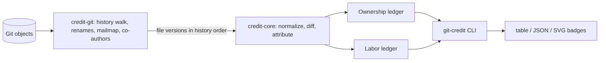

# git-credit: architecture and roadmap

This document holds the design decisions behind `git-credit`. It was drafted on
2026-11-08 from a planning pass and an independent review of that plan, then
narrowed by owner decisions. Change it in the same commit as any change to
attribution behavior.

## Goal

Per-author contribution stats for a Git repository that do not let trivial edits
steal credit, reported as two independent numbers:

- **Ownership**: share of the meaningful content at `HEAD`, attributed to the
  authors whose work survives in it.
- **Labor**: meaningful work across all analyzed history, including content later
  rewritten or deleted. For a fixed history and policy it never decreases because
  of other people's later edits.

These metrics describe provenance. They do not measure a person's value: a
one-line security fix can matter more than a thousand lines of boilerplate. The
README and reports say so.

## Architecture

| Crate         | Responsibility                                                              | Runtime dependencies           |
| ------------- | --------------------------------------------------------------------------- | ------------------------------ |
| `credit-core` | Normalization, diff, attribution, aggregation over in-memory inputs; no I/O | `similar` (from Phase 1)       |
| `credit-git`  | Object access, commit walk, rename detection, `.mailmap`, trailers          | `gix`                          |
| `git-credit`  | CLI, configuration, orchestration, table, JSON and SVG output               | `clap`, `serde`, `toml`, `globset` |
| `credit-syntax` (Phase 2) | tree-sitter adapters producing core token streams              | `tree-sitter` and grammars     |

### Dependency decisions

- **`gix` over `git2`:** permissive license (MIT OR Apache-2.0), pure Rust so no
  libgit2 native build on Windows, efficient object and tree access for replay. Its
  blame is not used: attribution needs custom provenance rules anyway.
- **`similar` in `credit-core`:** the core targets zero runtime dependencies, so this
  is a recorded exception. std has no diff algorithm; writing and maintaining a
  correct Myers or histogram diff is a project of its own. `similar` is
  Apache-2.0, widely used (it backs `insta`), maintained, and has no required
  dependencies. Before token attribution (Phase 2) it is benchmarked against
  `imara-diff` (histogram, interned inputs) on ordinary edits, repetitive tokens,
  generated files and near-total rewrites; the choice and its tie-breaking are then
  frozen into the algorithm version.
- All dependencies must pass `cargo deny` (permissive licenses only, crates.io only).

## Attribution model

### History walk (Phase 1: first parent)

Owner decision: Phase 1 walks the **first-parent** chain from the root to `HEAD`,
oldest first. A merge commit is diffed against its first parent, so work done on a
merged branch is attributed through the merge diff to the authors of the branch
commits where they can be matched, and otherwise to the merge author. This is
documented as approximate. Phase 2 replaces it with merge-aware replay over the
full commit graph.

Only the current state is kept in memory: one attribution vector per live file.
Labor accumulates once per visited commit into a per-author total. No historical
file attribution is retained. The implementation stores the first-parent commit
IDs to reverse the walk, so memory is live-tree state plus one commit's diff and
O(commit count) object IDs, rather than historical file contents. Side branches
are not replayed: existing first-parent provenance can survive a merge, but new
branch content falls back to the merge author and co-authors. Reports warn when
merges occur; recovering branch authors requires Phase 2's graph replay.

### Normalization (Phase 1)

Lines are the unit in Phase 1. Comparison uses a conservative normalization:
trailing whitespace is ignored and line-ending differences (CRLF vs LF) are
ignored. Leading indentation is also ignored for files whose language does not
give indentation meaning; for indentation-sensitive files (Python, YAML, Makefile,
and unknown extensions) indentation is kept, because there it can be a real change.
Interior whitespace, string contents and comments are compared as written.
Blank lines (empty after normalization, including whitespace-only lines) have
zero ownership weight and earn zero labor. They remain in file state for physical
alignment and move matching. All line diffs operate on the normalized nonblank
sequence, then map attribution and insertion candidates back to physical positions.
This applies to mixed meaningful/blank edits as well as formatting-only changes:
blank runs cannot become diff anchors that transfer unchanged meaningful content.
Adding, removing or relocating only blank lines is formatting. This corrects the
initial unreleased core's physical-line counting and alignment during Phase 1 review.
A commit whose included nonblank content is unchanged under normalization is a
**formatting commit**: it earns no labor and transfers no ownership. Renames and
moves remain meaningful structural changes. Commits containing only excluded
changes also count as formatting for the selected policy.

### Small edits keep the original author (Phase 1)

Owner decision: a similarity threshold.

Within a changed hunk, each new line is paired with the most similar old line in
that hunk (character-level similarity ratio, ties broken by position). For a pair
with similarity `s` (0 to 1):

- `s >= keep` (default `keep = 0.70`, meaning less than 30% changed): the line
  **keeps its previous owner**. The editor earns labor `1 - s` for the change.
- `s < keep`: the line is a rewrite. The editor **owns** it and earns labor 1.

Unpaired new lines are owned by the editor with labor 1. Deleted lines remove
ownership but never remove past labor. `keep` is configurable in `.git-credit.toml`.

The core implementation uses deterministic Myers diffs over nonblank normalized
lines. Character similarity is twice the Unicode scalar longest-common-subsequence
(LCS) length divided by the combined character count. Short lines use Myers to
obtain that count. For pairs with at least 256 scalars on each side and at most
128 distinct old scalars, an exact bit-parallel LCS computes the same count with
O(new length * ceil(old length / 64)) word operations. Mask storage is bounded by
the old alphabet and line length. This avoids the quadratic edit-distance cost of
large single-line SVGs without approximating scores or changing tie-breaking.
Differential tests check word boundaries, Unicode and agreement with Myers.
Cached character frequencies and length bounds skip only pairs that provably
cannot beat the current best score. Threshold comparisons use exact integer ratios. New lines are visited in order and each old line can be paired
only once. If a replacement hunk has more than 250,000 old/new candidate pairs,
pairing is skipped, the hunk is treated as a rewrite, and the core returns a
`pairing_capped` warning flag for the report layer.

Ownership and labor both use millionths of a line. Equal co-author ownership
splits allocate remainder units to the earliest authors in caller order.
Fractional labor rounds upward to the nearest millionth; cumulative integer
apportionment splits that amount among commit authors without losing units.
Blank physical lines have zero weight; a terminal newline does not add a line.
The presence or absence of the terminal newline alone is formatting. CLI and
configuration thresholds are rounded to the nearest per-mille value; reports
include the effective threshold, not the unquantized input.

Phase 2 refines this to tokens: unchanged tokens keep their provenance, inserted
and replaced tokens belong to the editor. The review of the original plan rejected
fractional ownership shares because they made results depend on statement size.

### Moves, copies and renames

Phase 1: renames are followed by exact content match and by similarity between a
deleted and an added path within the same commit. A line block that disappears
from one file and appears unchanged in another in the same commit keeps its
owners and earns no labor. The core's exact move pass requires at least three
consecutive lines, orders paths lexicographically and positions ascending, and
consumes each removed source line at most once. Copies therefore cannot multiply
ownership. Only removed lines not retained by within-file pairing and inserted or
rewritten destination lines participate. Reconcile all changes from one commit
before accumulating labor. Exact normalized three-line prefixes index move
candidates while preserving source-position order; blocks shorter than three are
rejected without scanning destinations. Fuzzy cross-commit move detection is Phase 3.

One isolated raw-object diff cache is built per analysis and reused across commits.
Its attribute stack has an empty ID mapping and no global or info attributes;
its pipeline has no worktree roots, drivers or text conversion. Staged and dirty
`.gitattributes`, configured diff drivers and attribute files cannot change a
report for the same committed history and policy. Transient blob resources are
cleared after each commit's tree diff, and the file-size cap also bounds rename
similarity resources.

### Identities

Authors are resolved through the `.mailmap` at `HEAD` consistently across all
history. `Co-authored-by` trailers split a commit's labor equally among the
author and co-authors after mailmap resolution; ownership of lines from that commit
is split the same way. Default identity groups use trimmed, lowercased display
names after mailmap resolution. Empty names fall back to canonical email keys.
`--by-email` or `group_by = "email"` instead groups by canonical email; the flag
overrides configuration. Canonical email matching is case-insensitive. Name
grouping is a heuristic: distinct people sharing a display name merge by default,
so users should select email grouping when names are ambiguous.

The terminal trailer paragraph is parsed case-insensitively. Participants are
deduplicated by group before equal splitting, with remainder units allocated in
sorted group-key order. Each canonical email is counted at most once per group
per analyzed commit (including formatting commits and co-author participation).
The most frequent address becomes the representative email, with lexical order
breaking ties. Display spelling comes from the group's first resolved name.
JSON lists all canonical merged addresses in a sorted `emails` array.

Opt-out matching against any merged canonical address anonymizes the entire group
retroactively. After replay, opted-out groups are combined into one anonymous
identity and all ownership, labor and directory IDs are remapped. The anonymous
row has an empty representative email and an empty `emails` array. Grouping and
privacy aggregation preserve total credit; zero-credit groups are not rendered.
These review corrections retain algorithm version 1 because it is unpublished.

The committed HEAD map is used even with a dirty worktree. Configured
`mailmap.blob` and trusted `mailmap.file` override it in that order; the latter
uses gix path expansion and is limited to 1 MiB. Malformed mailmap entries and
malformed co-author trailers are ignored, following Git's permissive convention.

### Exclusions

Applied before scoring: binary files, lockfiles (`Cargo.lock`, `package-lock.json`,
`pnpm-lock.yaml`, `yarn.lock`, `poetry.lock` and similar), common generated and
vendored paths, and globs from `.git-credit.toml`. Opted-out identities are reported
as one anonymous aggregate so percentages keep the same denominator.

Blobs containing NUL in their first 8000 bytes and blobs larger than the effective
size cap (default 1 MiB) are skipped with deduplicated warnings. Remaining text is
decoded as UTF-8 lossily, with a warning for invalid bytes. Symlinks and submodules
are not scored. Non-UTF-8 repository paths fail rather than being conflated by
lossy decoding. Filename indentation rules are conservative and case-sensitive;
unrecognized extensions preserve indentation.

The gix build enables only `sha1`, `revision`, `mailmap` and `blob-diff`, with no
default features or network transport backend. It reads raw tree blobs for rename
tracking, not worktree filters or external text conversion. SHA-256 repositories
are not supported by this Phase 1 build. `cargo tree -d` retains gix's transitive
hashbrown versions and the proc-macro syn major versions; there is no duplicate
native Git or TLS implementation. TOML uses its current parser to avoid a second
winnow major version.

### Complete history

Shallow clones and missing objects make roots look like history starts and would
inflate the first commit's author. `analyze` checks for a shallow repository before
doing any work and fails with the command that fixes it
(`git fetch --unshallow`). It never fetches by itself.

## Report contract

`--json` output carries a schema version, `ALGORITHM_VERSION`, the analyzed `HEAD`,
the walk mode (`first-parent`), the policy settings, units (`lines` in Phase 1),
warnings, per-author ownership and labor, and per-directory breakdowns. The shape is
documented in [json.md](json.md). Per-author and directory shares are fractions
in 0..=1; table output converts them to percentages. Directory depth defaults to
one, with root-level files under `.`. Depth zero disables the breakdown.

## Phases

### Phase 0: scaffold (done)

Workspace, licensing, README, AGENTS.md, CHANGELOG, `cargo deny` policy, commit and
text policy scripts with tests, CI on GitHub-hosted runners (policy, secret scan,
static checks, unit tests with coverage on Linux, Windows and macOS, builds
including the MSRV), weekly advisory audit, Dependabot.

### Phase 1: line-level MVP (done)

`git-credit analyze [PATH]` with table and `--json` output, first-parent walk,
normalization and formatting-commit detection, similarity threshold, renames and
same-commit moves, `.mailmap`, co-author trailers, exclusions, opt-out, per-directory
breakdown, shallow-clone check, `.git-credit.toml`.

Acceptance: fixture repositories prove each rule with exact expected totals: a
formatting commit changes nothing; an edit under the threshold leaves ownership
unchanged and adds fractional labor; an edit over it transfers the line; deleted
work stays in labor; a rename keeps owners; mailmap merges identities; co-authors
split credit; a shallow clone fails with the fix. stdout stays clean when piped.

### Phase 2: token level and merges

`credit-syntax` with tree-sitter (Rust, JavaScript and TypeScript first), token
attribution, merge-aware replay over the full graph with deterministic parent
precedence and labor counted once per commit, bulk find-and-replace detection with a
visible discount. Acceptance includes diamond merges never double-counting labor and
ownership mass being conserved.

### Phase 3: scale

Incremental cache keyed by algorithm version, policy digest and processed `HEAD`;
cold and incremental runs must produce identical output. Fuzzy move detection.
Benchmarks on large public repositories.

### Phase 4: badges and the GitHub Action

SVG contributor bar, per-person badges, summary card, bus-factor badge, shields.io
endpoint JSON. A reusable `action.yml` and a workflow that runs on every push to
`main` and force-pushes generated assets to an orphan `badges` branch; this
repository dogfoods it. Badge text is escaped and opted-out identities never appear.
