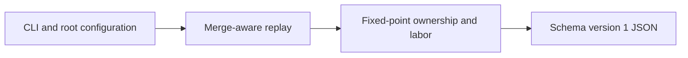

# JSON report contract



`git-credit analyze [PATH] --json` emits one JSON object to stdout. Diagnostics
remain on stderr. `--quiet` suppresses nonessential diagnostics but not report
warnings. No timestamps or ANSI sequences are inserted. Errors produce no partial
JSON and exit 1; invalid command-line usage exits 2.

## Version 1

Algorithm version 3 defaults to token attribution; `granularity = "line"` keeps
Phase 2a numbers. The schema version stays 1: new fields are additive and units
remain `lines`. Consumers comparing reports must check algorithm and granularity.

```json
{
  "schema_version": 1,
  "algorithm_version": 3,
  "head": "0123456789012345678901234567890123456789",
  "walk": "full",
  "units": "lines",
  "granularity": "token",
  "policy": {
    "bulk_discount": true,
    "keep": 0.7,
    "group_by": "name",
    "exclude": ["**/Cargo.lock", "generated/**"],
    "max_file_size": 1048576
  },
  "commits_analyzed": 3,
  "formatting_commits": 1,
  "bulk_edit_commits": 0,
  "authors": [
    {
      "name": "Alice",
      "email": "alice@example.test",
      "emails": ["alice@example.test", "old-alice@example.test"],
      "ownership_lines": 2.0,
      "ownership_share": 1.0,
      "labor": 3.1
    }
  ],
  "directories": [
    {
      "path": "src",
      "total_lines": 2.0,
      "authors": [
        {"email": "alice@example.test", "lines": 2.0, "share": 1.0}
      ]
    }
  ],
  "warnings": []
}
```

The example abbreviates exclusions. Actual `policy.exclude` includes every
built-in and custom glob, sorted and deduplicated.

| Field | Meaning |
| --- | --- |
| `schema_version` | Output structure version, currently 1 |
| `algorithm_version` | Attribution semantics version, currently 3 |
| `head` | Full analyzed committed HEAD SHA-1 object ID |
| `walk` | `full` by default; `first-parent` selects the legacy chain |
| `units` | Always `lines`; one ownership unit per meaningful physical output line |
| `granularity` | `token` by default; `line` selects Phase 2a attribution |
| `policy.bulk_discount` | Effective token bulk discount; always false in line mode |
| `policy.keep` | Line-mode similarity threshold rounded to per-mille precision; ignored in token mode |
| `policy.group_by` | `name` by default; `email` when selected through config or `--by-email` |
| `policy.exclude` | Effective repository-relative globs, including built-ins |
| `policy.max_file_size` | Maximum scored blob size in bytes, inclusive |
| `commits_analyzed` | Number of visited commits in the selected walk, including roots and HEAD |
| `formatting_commits` | Commits without meaningful included content changes; renames are not formatting |
| `bulk_edit_commits` | Commits with a discounted mapping; zero with discounts disabled or in line mode |
| `authors` | Authors with positive ownership or historical labor, ordered by ownership descending, name, then email |
| author `email` | Most frequently used canonical email in the group; lexical tie-break |
| author `emails` | Sorted distinct canonical emails merged into the group; empty for anonymous |
| `ownership_lines` | Current ownership in meaningful lines, fractional for token weights and co-authors |
| `ownership_share` | Fraction of all live ownership, from 0 to 1, not a percentage |
| `labor` | Historical meaningful work in lines, including later deletions |
| `directories` | Sorted directory breakdown at `--depth`; empty when depth is zero |
| `total_lines` | Total live ownership in that directory |
| directory author `lines` | That author's ownership in that directory |
| directory author `share` | Fraction of directory ownership, from 0 to 1 |
| `warnings` | Sorted, deduplicated messages about skipped files, lossy decoding, pairing caps, bulk discounts and approximate merges (legacy walk only) |

Root files belong to directory `.`. Empty directories represented by live empty
files may have zero totals and no authors. Shares are zero when their denominator
is zero. Empty repositories are errors, but a committed empty tree yields a valid
report with empty authors and directories.

Internally ownership and labor use integer millionths of a line. JSON numbers are
converted to floating-point only for presentation, so consumers should allow
floating-point tolerance when summing. Equal co-author shares allocate remainder
units in sorted group-key order, after deduplicating participants by group.

By default, trimmed and lowercased mailmap-resolved display names identify groups;
empty names fall back to canonical emails. `--by-email` or `group_by = "email"`
in `.git-credit.toml` keeps different addresses separate. Name grouping can merge
distinct people with the same name; use email grouping when this is undesirable.
The first resolved name supplies display spelling. Email frequency counts each
address once per group per analyzed commit, including co-author and formatting
participation. Directory rows use the group's representative email.

Opt-out matching applies to any canonical merged address, including addresses
encountered later in history. The whole group's earlier and later credit becomes
anonymous. All opted-out groups merge into one row with `name: "anonymous"`,
`email: ""` and `emails: []`; directory breakdowns also use the empty email. Their
combined ownership remains in all denominators. Neither policy metadata nor
`emails` reveals opted-out addresses.

These are provenance statistics, not a measure of a person's value. In `full`
mode each reachable commit is visited once in parent-before-child order, with
object ID tie-breaking. Merge blobs matching another parent preserve its ownership
with zero labor. Inserted tokens matching any other parent inherit that parent
owner (parent order, then earliest token occurrence) and refund insertion labor.
First-parent equal tokens are untouched. Line mode retains normalized-line
matching and the original small-edit rule. Only unmatched content is new merge work.

`--first-parent` or `walk = "first-parent"` in `.git-credit.toml` selects legacy
attribution: new branch content in merge diffs goes to merge authors and trailers,
with an approximation warning. `walk = "full"` is the default. Algorithm version 3
applies to both walks and granularities; schema version remains 1. Identity display spelling follows
the first resolved occurrence in the deterministic selected walk. Verbose stderr
also reports peak retained commit states; that diagnostic is not a JSON field.

## Token accounting and bulk discounts

Words, numbers, strings and significant indentation have lexical weight 1000;
punctuation has weight 250. A trailing comma before a closing bracket has zero
weight. Whitespace-only lines are weightless. Each meaningful physical output
line contributes exactly 1,000,000 internal ownership units, split by token weights
and accumulated author shares. Cumulative division in author-ID order conserves
that total. Rewrapping can change the count of ownership lines without changing
any token owner or earning labor.

Ordinary labor is inserted token weight / total line token weight, rounded down
to millionths per line and split exactly among editors. Deletions earn zero.
String contents and significant indentation are meaningful. Parent and move
reconciliation remove insertion candidates before accounting, avoiding repeated
rounding refunds. Token moves require three complete meaningful lines on each side;
blank lines may bridge them and canonical token runs ignore internal whitespace.

Only identifier-to-identifier replacements are bulk candidates. Numbers, strings,
boolean/null literal names, common language keywords, comment words, punctuation,
operators and indentation remain ordinary editor work, even when the same spelling
mapping qualifies elsewhere in code. All replacements remain in the denominator.

A bulk mapping needs at least five paired replacements and at least 60% of the
commit's remaining replaced-token weight. Equal-length replacement hunks provide
pairs; unmatched replacement hunks still contribute to the denominator. Inherited
parent and moved tokens are excluded. Discounted tokens retain owners; the editor
earns exactly one labor line per distinct qualifying mapping per file, in addition
to any unrelated edits. This fixed charge is not capped by ordinary fractional
labor. `bulk_edit_commits` counts affected commits once. One warning lists up to five
full example commit IDs in deterministic replay order. `--quiet` suppresses stderr,
not this warning in JSON. `--no-bulk-discount` or `bulk_discount = false` disables
both the preservation and fixed-charge rule, restoring ordinary token attribution.
