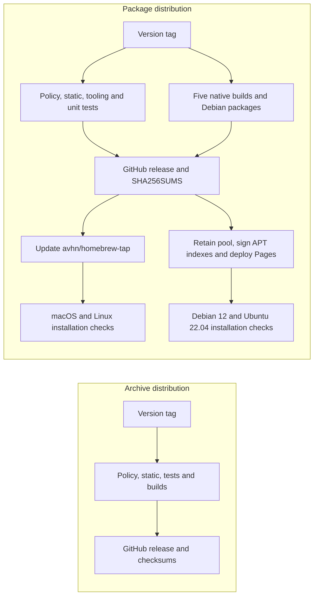

# Release packaging and distribution

`git-credit` provides fair git authorship stats. Tagged releases publish the same
built executables through GitHub archives, Homebrew and signed APT packages.
No attribution algorithm or report schema changes are involved in packaging.

## Publication path



The tag must equal `v<workspace version>` in `Cargo.toml`. All required gates and
builds directly gate the release and both distribution jobs. Empty publishing
secrets fail with named diagnostics instead of silently disabling a channel.
The `v*` tag ruleset limits tag creation to repository admins. The tap publishing
job uses the `homebrew-tap` environment, whose deployments allow only `v*` tags;
it owns `HOMEBREW_TAP_DEPLOY_KEY`. APT signing and deployment use `github-pages`,
which allows `main` and `v*` tags and owns `APT_SIGNING_KEY` and
`APT_SIGNING_PASSPHRASE`. These are environment secrets, not repository secrets.
Use stable `vX.Y.Z` tags: the package and formula renderers reject prereleases.
A failed distribution job does not roll back an already-created GitHub release.
Inspect run logs and retry the failed job after correcting the cause. Do not
replace release asset bytes; bump the version if the package content changes.

### Native binaries and Debian packages

Linux targets are `x86_64-unknown-linux-musl` on `ubuntu-latest` and
`aarch64-unknown-linux-musl` on `ubuntu-24.04-arm`, both using native `musl-tools`.
The workflow rejects an ELF program interpreter and smoke-tests each binary.
Static musl avoids a runner's glibc baseline; intended distro support is Debian
11+ and Ubuntu 20.04+. Kernel and architecture compatibility still apply.
macOS archives cover Intel and Apple Silicon; Windows covers x86_64 MSVC.

`tools/package-release.py` writes flat archives containing the executable,
`README.md`, `LICENSE-MIT` and `LICENSE-APACHE`. `tools/package-deb.sh` wraps each
Linux binary with `dpkg-deb`, without rebuilding or running it. Packages are named
`git-credit_<version>-1_<amd64|arm64>.deb` and contain:

- `/usr/bin/git-credit`
- `/usr/share/doc/git-credit/copyright` (DEP-5, MIT or Apache-2.0)
- `README.md`, upstream `changelog.gz` and `changelog.Debian.gz` in that doc directory

The package uses section `vcs`, priority `optional` and `Recommends: git`.
There is no `Depends: git`: gix reads Git objects itself. There are no maintainer
scripts. Root ownership, permissions, gzip metadata and timestamps are normalized;
`SOURCE_DATE_EPOCH` is the tagged commit time. Linux executables are stripped
before both archive and Debian packaging. Lintian errors fail Linux builds;
warnings remain visible but non-fatal. The sole override is
`statically-linked-binary`, because static musl is deliberate for portability.
The DEP-5 Apache paragraph references Debian's common-license file; MIT is included
in full. Both debs join all five archives in the
GitHub release and `SHA256SUMS`. The publish job also uploads its locally generated
`SHA256SUMS` as the attempt-named `release-provenance-<attempt>` run artifact,
retained for 14 days. Homebrew and APT jobs download its exact immutable artifact
ID from the successful publish job output, so retries cannot select a stale
attempt by name. A missing or expired artifact fails closed. Both jobs use
that artifact as their source of truth, require the downloaded release manifest
to match it byte-for-byte, and verify every expected downloaded payload against
its hashes before publishing either channel. A replacement payload and matching
replacement release manifest cannot substitute for the build-run artifact.

The composite action selects Linux musl assets from the manifest. If musl is
absent, it accepts the legacy GNU name used by v0.1.0. A malformed or duplicate
musl checksum fails rather than triggering a downgrade. Archive extraction still
copies only the verified regular executable, never other archive paths or links.

### Homebrew tap

`tools/render-homebrew.sh VERSION SHA256SUMS OUTDIR` requires a new output path
and exactly one valid SHA-256 per macOS/Linux architecture. The formula installs
only `git-credit`, declares MIT OR Apache-2.0 and tests its version. The release
job syntax-checks Ruby before publishing. Post-publication jobs run installation,
`brew test`, `brew style` and `brew audit --strict --online` on macOS and Linux.

`HOMEBREW_TAP_DEPLOY_KEY` is loaded into an ephemeral SSH agent with write access
only to `avhn/homebrew-tap`. GitHub host keys come from authenticated HTTPS.
The bot changes only `Formula/git-credit.rb` and appends missing install commands
to the tap README using `tools/update-tap-readme.py`. It never changes
`Formula/fortix.rb` or removes existing README content. Commits use
`git-credit-release[bot]` with messages such as `git-credit 0.1.1`.

### Retained APT repository and Pages

Site: <https://avhn.github.io/git-credit/>.
APT source: `https://avhn.github.io/git-credit/apt stable main`.

`tools/prepare-pages.sh` fetches the retained `gh-pages` branch or creates an
orphan on the first release. HTTP credentials are supplied by an extraheader,
not embedded in URLs. Normal fast-forward pushes reject conflicting writers.
The release APT job and manual Pages job share the non-cancelling
`git-credit-apt-repository` concurrency group from branch read through deployment.
Only the APT/Pages deploy jobs grant `pages: write` and `id-token: write`.
The release upload and retained branch updates also need `contents: write`.

`tools/build-apt-repo.sh` rejects symlinks, unsafe or mismatched package metadata,
and attempts to overwrite an existing package with different bytes. Before any
new packages are copied, `tools/verify-apt-repo.py` verifies the retained
`InRelease` with `gpgv` using only committed public keys and an allowed signer
fingerprint. It checks both architecture indexes and compressed indexes against
the signed SHA-256/size records, then checks the complete old pool against the
verified `Packages` entries. Changed, missing and unlisted retained packages
fail closed. Without an existing `InRelease`, the pool must be empty before the
new uploads are added. Manual Pages rebuilds apply the same retained-byte checks.
Published binary and armored keyrings must each contain exactly one matching
primary key; retained site keys never establish trust. Packages
accumulate in `apt/pool/main/g/git-credit/`. Both architecture indexes include
retained versions. `apt-ftparchive` produces `Packages`, deterministic
`Packages.gz`, and `Release` with Origin/Label `git-credit`, Suite/Codename
`stable`, Components `main`, and Architectures `amd64 arm64`.

The workflow imports `APT_SIGNING_KEY` into a private temporary `GNUPGHOME` and
requires exactly the expected primary fingerprint. It also checks the committed
public key. GPG signs `InRelease` and `Release.gpg` using
`APT_SIGNING_PASSPHRASE` through a private descriptor, not argv. It verifies both
signatures and exports the public key as `apt/git-credit-archive-keyring.gpg`
(binary/dearmored) and `.asc`. The signing directory and agent are cleaned on exit.
Secrets are never logged. All retained site symlinks are rejected before rendering
or upload because Pages archiving can dereference links.

The branch is storage, not the Pages build source: `actions/upload-pages-artifact`
and `actions/deploy-pages` explicitly deploy it. A `GITHUB_TOKEN` branch push alone
does not trigger a Pages rebuild. After deployment, Debian 12 and Ubuntu 22.04
containers verify the public key fingerprint, use `signed-by`, and install the
exact released package version. Those jobs test amd64; native arm64 build smoke
tests and package-index separation cover arm64 without a live arm64 APT install.

## Signing key and rotation

Expected primary fingerprint:

```text
097DDFE92CE4B0F4E204F434668F8E1D756456FD
```

The public source is `packaging/apt/git-credit-archive-keyring.asc`. Only the
repository owner manages private keys and the three publishing secrets. Do not
put private keys, passphrases or deploy keys in source, command arguments or logs.

For a planned signing-key rotation:

1. Regenerate and protect the replacement key offline. Independently verify its
   full primary fingerprint and announce the new public key through reviewed
   source documentation, not just the download endpoint. Never expose a private
   key or passphrase to the agent, command arguments or logs.
2. Set the regenerated `APT_SIGNING_KEY` and `APT_SIGNING_PASSPHRASE` as secrets in
   the `github-pages` environment. Keep the tap's separate deploy key in the
   `homebrew-tap` environment. Coordinate this with a source update to the current
   public key, fingerprint in scripts/workflows, README, tests and this document.
3. For the one-time retained-repository transition, commit the prior public key
   separately at `packaging/apt/git-credit-previous-archive-keyring.asc`, containing
   exactly one primary key. Set the non-secret `APT_PREVIOUS_FINGERPRINT` variable
   in `github-pages` to its independently reviewed full fingerprint. Both release
   and manual Pages jobs forward it to the verifier. The variable alone grants no
   trust: the old public key must also be committed and match that fingerprint.
   Never take a previous trust key from the retained branch. Do not enable a
   compromised key as a previous key.
4. Publish the new release. The old `InRelease` is accepted only under the current
   or explicitly enabled previous fingerprint, so the old pool can be verified
   before re-signing with the new key. Exported/published keyrings still contain
   only the single new key, not both keys. Existing clients must separately
   refresh their installed single-key keyring using the authenticated rotation
   instructions; `APT_PREVIOUS_FINGERPRINT` does not change client trust.
5. Verify new signatures and fresh-install/existing-client upgrade checks. Remove
   the previous-fingerprint environment variable and committed previous public
   key immediately after successful migration. A retry then verifies the retained
   repository with the new key alone. Retain the old revocation certificate
   securely; for compromise, revoke immediately and provide independently
   authenticated keyring replacement and repository recovery instructions.

## Rebuild Pages without a release

Run the **Pages** workflow manually on `main` (Actions UI), or:

```sh
gh workflow run pages.yml --repo avhn/git-credit --ref main
```

It requires an existing `gh-pages` branch and signed APT repository, regenerates
only the installation page and `.nojekyll`, retains package/index/signature bytes,
commits changed pages, and deploys under the same lock. It does not import signing
secrets, rebuild binaries, regenerate APT indexes or re-sign metadata. Publish a
new release to add packages or replace signatures. Re-running an older release
never removes newer retained packages, but would still update its Homebrew formula;
coordinate retries across channels to avoid downgrading the tap.

## Local checks and limitations

Run `bash tools/tests/packaging.test.sh` for fixture-manifest formula rendering,
invalid-input guards, append-only README behavior, missing-secret diagnostics,
deterministic debs, signatures, architecture separation, retained-version tests,
tampered/unlisted packages, changed indexes, wrong signers, single-key keyrings,
build-run checksum provenance and the one-time previous-key transition.
The Debian/signing integration portion explicitly skips when Linux packaging
tools are unavailable; Linux CI installs `apt-utils` so it runs there. Tests use
an isolated throwaway key, inert binaries, and no publication credentials.
Ruby syntax validation runs where Ruby is available. No local test proves deploy
key access, production signing, Pages propagation, Homebrew online audits or an
actual public APT install. Those require the owner-triggered tagged release.
